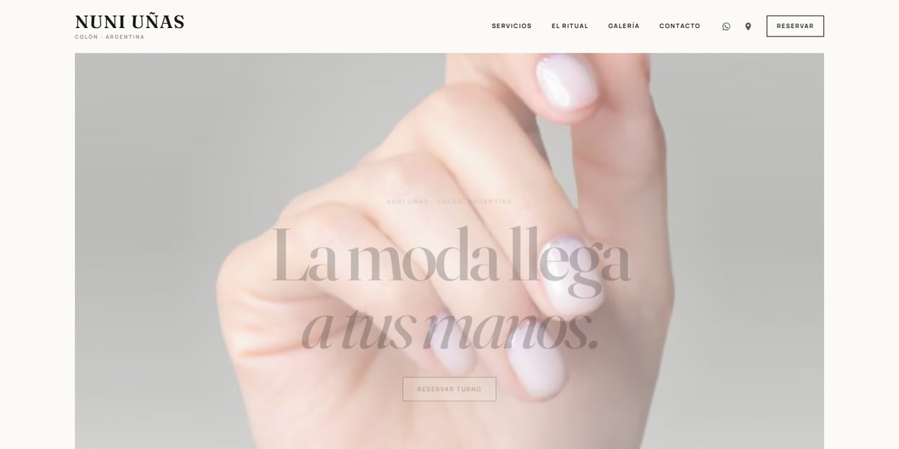

# Nuni Uñas — landing de conversión para reservas por WhatsApp

> Caso de estudio de una landing mobile-first para una emprendedora de manicura en Colón, Entre Ríos. El objetivo: transformar visitas en conversaciones de WhatsApp con contexto, ordenar el primer contacto y acompañar una meta de negocio de **+20% de clientas en 6 meses**.



`HTML5` · `CSS3` · `JavaScript vanilla` · `Accesibilidad` · `Performance` · `Neuroventas` · `SEO local`

---

## 1. El punto de partida

Nuni Uñas es un emprendimiento de manicura semipermanente, ojo de gato y belleza de manos. Su presencia digital dependía de redes sociales y de conversaciones sueltas por WhatsApp.

El problema no era “tener una web”. El problema era **convertir interés en turnos confirmados sin agregar complejidad a la agenda de Nuni**.

Desafíos detectados:

- La agenda se coordinaba por WhatsApp, con idas y vueltas para obtener servicio, fecha, franja, color y datos de contacto.
- Muchas consultas llegaban incompletas o fuera del horario de atención.
- La propuesta de valor, los precios y la garantía no estaban reunidos en un solo lugar.
- En belleza, la decisión es emocional y ocurre en el teléfono: si la web tarda o el botón no está a mano, se pierde el interés.
- La marca necesitaba transmitir confianza: precio claro, garantía de 7 días y un trato humano.

La clienta planteó una meta concreta: **aumentar sus clientas en un 20% en 6 meses**. Esa meta se tomó como hipótesis de negocio y se tradujo en un embudo medible, no como una promesa de resultado.

## 2. La solución

Una landing estática, rápida y mobile-first que hace tres cosas:

1. **Comunica** servicios, precios, estilo y garantía.
2. **Guía** a la reserva con un formulario breve que arma un mensaje completo.
3. **Deriva a WhatsApp** en una pestaña nueva, con el mensaje listo para enviar.

No se reemplazó a la persona: se le quitó fricción al primer contacto. La confirmación final sigue siendo de Nuni.

```text
Visita → CTA “Reservar” → formulario → validación → mensaje estructurado → WhatsApp → confirmación humana
```

### Cómo se abordaron la agenda y los contactos

- **Menos preguntas repetidas:** el formulario captura la información mínima para cotizar y coordinar.
- **Agenda más ordenada:** la clienta propone fecha y franja; Nuni confirma disponibilidad.
- **Contacto válido:** validación de nombre y WhatsApp, más consentimiento explícito para contactar.
- **Urgencia con regla:** el adicional de +$5.000 solo aplica dentro de las próximas 48 h y está sujeto a disponibilidad.
- **Handoff limpio:** WhatsApp abre en pestaña nueva con un mensaje que evita el “Hola, ¿precio?” sin contexto.
- **Sin backend prematuro:** se priorizó validar el flujo y la demanda antes de invertir en un calendario o CRM.

> **Alcance honesto:** esta versión no automatiza la agenda ni cobra señas. Ordena la solicitud y mejora el handoff. La automatización completa queda en el roadmap.

### Qué recibe Nuni en cada consulta

El mensaje se arma con este formato:

```text
Hola Nuni! Quiero reservar un turno.
Nombre: ...
Servicio: ...
Fecha: dd/mm/aaaa
Franja: ...
Mi WhatsApp: ...
Color de referencia: ...
Nota: ...            # solo si se completó
Urgente: Sí ...      # solo si se marcó
¿Me confirmás disponibilidad? Gracias!
```

## 3. Por qué esto también es neuroventas

No se trata de “vender con trucos”, sino de reducir carga cognitiva, ordenar la decisión y aumentar claridad.

| Decisión de diseño | Principio aplicado |
|---|---|
| Precio visible antes de la conversación | Reduce incertidumbre y sensación de riesgo |
| Formulario corto y guiado | Disminuye esfuerzo cognitivo |
| Elegir servicio, fecha y color antes de WhatsApp | Genera microcompromisos y aumenta la implicación |
| Garantía de 7 días y precio claro | Construye confianza y reduce objeción |
| Urgencia con condición explícita | Escasez honesta, sin manipulación |
| CTA repetido en puntos de decisión | Facilita la acción en el momento de mayor intención |
| WhatsApp como destino final | Cero fricción: la clienta ya vive ahí |
| Lenguaje “te confirmo yo”, “sin sorpresas” | Vínculo humano y previsibilidad |

**Lo que se evitó a propósito:** testimonios inventados, falsas reseñas, contadores de escasez ficticios y promesas de resultados. La confianza también se construye con lo que no se hace.

## 4. Métricas para validar la meta de +20%

La meta de negocio se descompone en un embudo simple:

```text
Nuevas clientas = visitas × tasa de consulta × tasa de cierre
```

Para comparar contra una línea base, se recomienda medir los 3 meses previos y revisar mensualmente:

| Métrica | Qué mide | Fuente propuesta |
|---|---|---|
| Clics a WhatsApp | Intención de contacto | Evento de analítica / UTM |
| Formularios iniciados | Interés en reservar | Evento en `data-open-booking` |
| Formularios completados | Calidad del flujo | Submit exitoso |
| Tasa de finalización | Completados / iniciados | Analítica |
| Consultas con datos completos | Menos ida y vuelta | Muestreo manual de WhatsApp |
| Turnos confirmados | Conversión real | Agenda de Nuni |
| Recurrencia a 30/60 días | Retención | Seguimiento de clientas |
| Origen del tráfico | Qué canal trae clientas | UTM / redes |

> Hoy no hay una herramienta de analítica instalada. El siguiente paso es instrumentar eventos sin datos personales y establecer una línea base antes de atribuir mejoras al sitio.

Plan de 6 meses:

1. **Mes 0:** medir línea base y definir tablero simple.
2. **Mes 1:** publicar la landing y activar Google Business Profile / enlaces en redes.
3. **Mes 2-3:** optimizar CTA, formulario y tiempo de respuesta.
4. **Mes 4-5:** trabajar recurrencia, referidos y contenido local.
5. **Mes 6:** comparar contra la línea base y decidir próximas inversiones.

## 5. Tecnologías

| Capa | Tecnología | Por qué |
|---|---|---|
| Estructura | HTML5 semántico | Accesibilidad, SEO y mantenimiento simple |
| Estilos | CSS3 con custom properties, Grid, Flexbox y `clamp()` | Diseño responsive sin framework |
| Interacción | JavaScript ES6+ vanilla | Sin dependencias de runtime ni peso extra |
| SEO local | JSON-LD `NailSalon` + Open Graph | Contexto para buscadores y redes |
| Conversión | WhatsApp deep links (`wa.me`) | El canal que la clienta ya usa |
| Imágenes | AVIF, WebP y JPEG con `<picture>` + Sharp | Calidad visual con menor peso |
| Seguridad | CSP por hash, `referrer`, `noopener,noreferrer` | Superficie de ataque mínima |
| Calidad | `agent/audit.mjs` + `html-validate` | Verificación reproducible antes de publicar |
| Preview | Python `http.server` | Servidor local sin instalar nada más |
| Versionado | Git + GitHub | Historial y publicación del caso de estudio |

No hay frameworks, backend, base de datos, cookies propias ni proceso de build.

## 6. Calidad y resultados técnicos

- **Auditoría propia:** 11 comprobaciones, 0 errores, 0 avisos.
- **21 variantes de imagen** (7 fotos × AVIF/WebP/JPEG), aproximadamente **184 KB en AVIF**.
- Foto de “Belleza de pies” actualizada a un **AVIF real de 1200 × 900**.
- Formulario probado con datos inválidos y válidos; mensaje verificado con nombre compuesto y apóstrofe.
- Modal y lightbox con focus trap, cierre con `Escape` y restauración de foco.
- `node --check script.js` sin errores.
- `npx --yes html-validate index.html` sin errores.
- Consola del navegador sin errores ni avisos en la última revisión.
- Sin secretos, sin PHP y sin datos personales almacenados.

### Seguridad del repositorio público

- La CSP por hash bloquea scripts inline no autorizados.
- No se usa `innerHTML`, `eval` ni `new Function`.
- Los datos del formulario se codifican con `encodeURIComponent` antes de entrar en la URL de WhatsApp.
- Los enlaces externos usan `noopener,noreferrer`.
- No hay `.env`, tokens, claves privadas ni credenciales versionadas.
- Las imágenes no conservan metadatos EXIF/XMP/IPTC.
- La política de reporte y el detalle de controles están en **[SECURITY.md](SECURITY.md)**.

Comandos reproducibles:

```powershell
python -m http.server 8000 --bind 0.0.0.0
node --check script.js
node agent/audit.mjs
npx --yes html-validate index.html
```

## 7. Estructura del repositorio

```text
.
├── index.html
├── styles.css
├── script.js
├── fonts.css
├── README.md
├── SECURITY.md
├── .gitignore
├── .gitattributes
├── assets/
│   └── fonts/
├── imagenes/
│   ├── originales/
│   │   └── ritual-pies.png
│   └── optimized/
│       └── ... (AVIF, WebP y JPG)
├── docs/
│   ├── preview.jpg
│   ├── caso-de-estudio.md
│   └── publicacion-github.md
└── agent/
    ├── audit.mjs
    └── Agent.md
```

## 8. Cómo ejecutarlo

```powershell
# Desde la raíz del proyecto
python -m http.server 8000 --bind 0.0.0.0
```

Abrir `http://127.0.0.1:8000/`.

Para evitar caché durante una revisión:

```text
http://127.0.0.1:8000/?v=20
```

## 9. Publicación en GitHub

El paso a paso completo está en **[docs/publicacion-github.md](docs/publicacion-github.md)**.

Resumen:

```powershell
git init
git branch -M main
git add .
git commit -m "feat: landing de conversión para Nuni Uñas"
git remote add origin https://github.com/TU-USUARIO/nuni-unas-landing.git
git push -u origin main
```

Después, en GitHub:

1. Completar **About**: descripción, sitio y topics.
2. Subir `docs/preview.jpg` como **Social preview**.
3. Activar **GitHub Pages** desde `main` / root si se quiere una demo pública.
4. Crear el release `v1.0.0`.

## 10. Roadmap

### Ahora

- Landing publicada y estable.
- Flujo de reserva por WhatsApp con mensaje estructurado.
- Imágenes optimizadas y auditoría reproducible.

### Próximo

- Instrumentar analítica y línea base.
- Medir el embudo completo hasta turno confirmado.
- Optimizar copy/CTA con pruebas A/B.
- Google Business Profile y SEO local.

### Más adelante

- Calendario de disponibilidad y señas.
- Recordatorios automáticos.
- CRM simple y seguimiento post-turno.
- Programa de referidos y recurrencia.
- CDN y `srcset` con múltiples anchos si la galería crece.

## 11. Para reclutadores IT y especialistas en neuroventas

Este repositorio busca mostrar criterio, no solo código:

- **Product thinking:** traducción de un problema de negocio a una solución técnica simple.
- **Diseño de conversión:** jerarquía de CTA, reducción de fricción y handoff humano.
- **Frontend craft:** HTML/CSS/JS sin dependencias, accesibilidad, performance y CSP.
- **Neuroventas éticas:** claridad, microcompromisos, prueba de confianza y urgencia honesta.
- **Calidad:** auditoría propia, validación HTML, pruebas de formulario y foco.
- **Documentación:** decisiones, métricas y roadmap explicitados.

Si querés ver el razonamiento completo, abrí **[docs/caso-de-estudio.md](docs/caso-de-estudio.md)**.

## 12. Derechos y créditos

- Marca, textos, fotografías y datos de contacto: **Nuni Uñas**.
- Código y documentación: caso de estudio de portfolio. No se autoriza la reutilización comercial de la identidad visual ni de las fotos sin permiso.
- Tipografías: **Fraunces** y **Manrope**, autohospedadas bajo SIL Open Font License.
- Iconos: SVG inline propios del proyecto.

---

### English summary

A mobile-first conversion landing for a nail studio in Colón, Argentina. It organizes service, date, time, contact and style preferences into a structured WhatsApp message, reducing booking friction while keeping human confirmation. Built with semantic HTML, vanilla CSS/JS, accessible dialogs, CSP, and optimized AVIF/WebP/JPEG images. The project documents the business goal (+20% clients in six months), the measurement plan, and the ethical use of persuasion principles.
